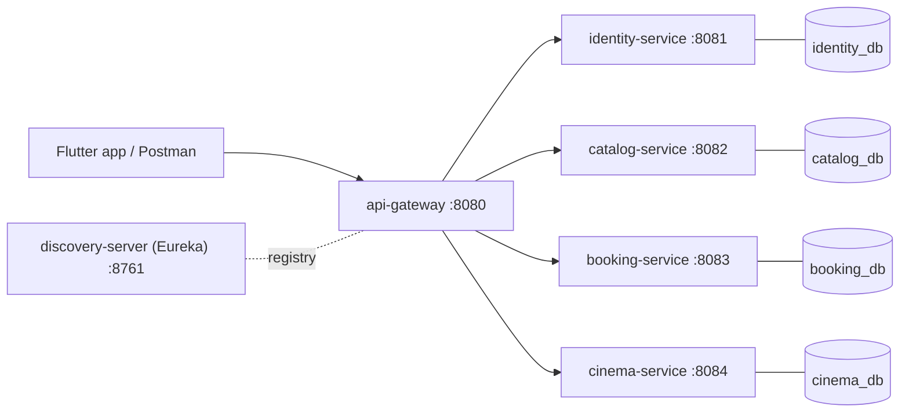

# Cinema Management Microservices

[English](README.md) | [Tiếng Việt](README.vi.md)

A microservices backend (with a Flutter customer app) for cinema management and online ticket booking. It was migrated from a Spring Boot monolith and built by a team of 6 students at FPT University as part of the MSS301 course.


## Highlights

- **4 domain services + gateway + service discovery**, each domain service owns its own database (database-per-service).
- **JWT (RS256) authentication** issued by `identity-service`; other services verify tokens through a public **JWKS** endpoint.
- **Role-based access control**: customer and admin endpoints are separated and enforced at the service level.
- **Database migrations with Flyway** (no Hibernate schema auto-update); separate `migrator` and `app` SQL logins per database.
- **Seat hold → booking flow** with a 5-minute hold, quote with vouchers and concessions.
- **One-command local run** with Docker Compose and health-check based startup order.
- Optional **monitoring stack** (Prometheus, Grafana, Zipkin) via a Compose profile.
- **Flutter customer app** (Provider + MVVM, GoRouter, Dio).

## Architecture



| Service | Port | Responsibility |
|---|---|---|
| `api-gateway` | 8080 | Single entry point, routing, JWT verification |
| `discovery-server` | 8761 | Eureka service registry |
| `identity-service` | 8081 | Register / login, JWT RS256, JWKS, accounts and roles |
| `catalog-service` | 8082 | Movies, concessions (food and drinks), watchlist |
| `booking-service` | 8083 | Seat holds, bookings, demo payment, vouchers |
| `cinema-service` | 8084 | Rooms, seat maps, showtimes |

Service conventions and API contracts are documented in [AGENTS.md](AGENTS.md) and [`docs/contracts/`](docs/contracts) (OpenAPI YAML files).

## Tech Stack

| Area | Technology |
|---|---|
| Language / Framework | Java 21, Spring Boot 3.5.4, Spring MVC, Spring Data JPA |
| Microservices | Spring Cloud Gateway, Eureka, OpenFeign |
| Security | Spring Security, JWT RS256, JWKS |
| Database | Microsoft SQL Server 2022, Flyway |
| DevOps | Docker, Docker Compose, GitHub Actions |
| Observability | Prometheus, Grafana, Zipkin (optional profile) |
| Mobile client | Flutter, Dart, Material 3, Provider, GoRouter, Dio |

## Getting Started

**Prerequisites:** Docker Desktop (Docker Engine running). About 6 GB of free RAM is recommended.

```bash
# 1. Create your local environment file (Linux/macOS)
cp .env.example .env
#    Windows PowerShell: Copy-Item .env.example .env

# 2. Build and start everything
docker compose up -d --build

# 3. (Optional) start the monitoring stack too
docker compose --profile monitoring up -d
```

Edit `.env` and replace the `ChangeMe_...` placeholder passwords before running anything beyond a local demo.

Startup order is controlled by health checks: `sqlserver` → `db-init` (creates 4 databases and least-privilege logins) → `discovery-server` → `identity-service` → `catalog` / `cinema` / `booking` → `api-gateway`.

### Try it

This public copy does not ship seed accounts. Register one through the gateway:

```bash
# Register
curl -X POST http://localhost:8080/api/v1/auth/register \
  -H "Content-Type: application/json" \
  -d '{"username":"demo_user","password":"<your-password>","confirmPassword":"<your-password>","email":"demo_user@example.com","phone":"0900000001","dob":"2000-01-01","sex":true}'

# Login and copy the accessToken
curl -X POST http://localhost:8080/api/v1/auth/login \
  -H "Content-Type: application/json" \
  -d '{"username":"demo_user","password":"<your-password>"}'

# Browse the public movie catalog
curl http://localhost:8080/api/v1/movies
```

More end-to-end examples are in the Vietnamese guide ([README.vi.md](README.vi.md), section 4) and in the Postman collections under [`docs/postman/`](docs/postman).

> Movies, rooms and showtimes need seed data. See [`docs/dev/local-seed/`](docs/dev/local-seed) for the local seed scripts.

### Flutter app

The customer app lives in [`cinema_booking_app/`](cinema_booking_app). See its own [README](cinema_booking_app/README.md) for setup, and make sure the backend is running through the gateway first.

## Project Structure

```
.
├── services/
│   ├── identity-service/    # auth, JWT, accounts
│   ├── catalog-service/     # movies, concessions, watchlist
│   ├── cinema-service/      # rooms, seats, showtimes
│   └── booking-service/     # seat holds, bookings, vouchers
├── infrastructure/
│   ├── api-gateway/
│   └── discovery-server/
├── cinema_booking_app/      # Flutter customer app
├── Cinema_Management/       # original monolith (kept for reference)
├── docs/                    # API contracts, Postman, migration notes
├── monitoring/  elk/        # observability configs
└── compose.yaml             # one-command local environment
```

## My Contributions

I worked on this project as one of 6 team members (see the Git history of the original team repository for per-author commits). My part:

**Catalog service (concessions)**
- Built the concession CRUD API (admin create / update / soft delete, customer read-only for active items).
- Wrote the Flyway migrations for the concession tables, including `version` for optimistic locking.

**Booking service (vouchers)**
- Implemented admin voucher management and added the matching API Gateway routes.

**Flutter customer app**
- Concession catalog screen with All / Popcorn / Drinks filters and a shared cart ViewModel.
- Cart connected to the booking quote: seat-hold context, voucher apply / remove, error recovery, and skipping concessions while keeping held seats.

**Team**
- Drafted the shared `AGENTS.md` conventions used by the team.

## Notes

- This is a **sanitized copy** of a team project, published for learning and portfolio purposes. Real credentials, personal data and legacy account data have been removed or replaced with placeholders, so some flows need your own seed data.
- No license file is included yet. All rights reserved by the original authors until one is added.
