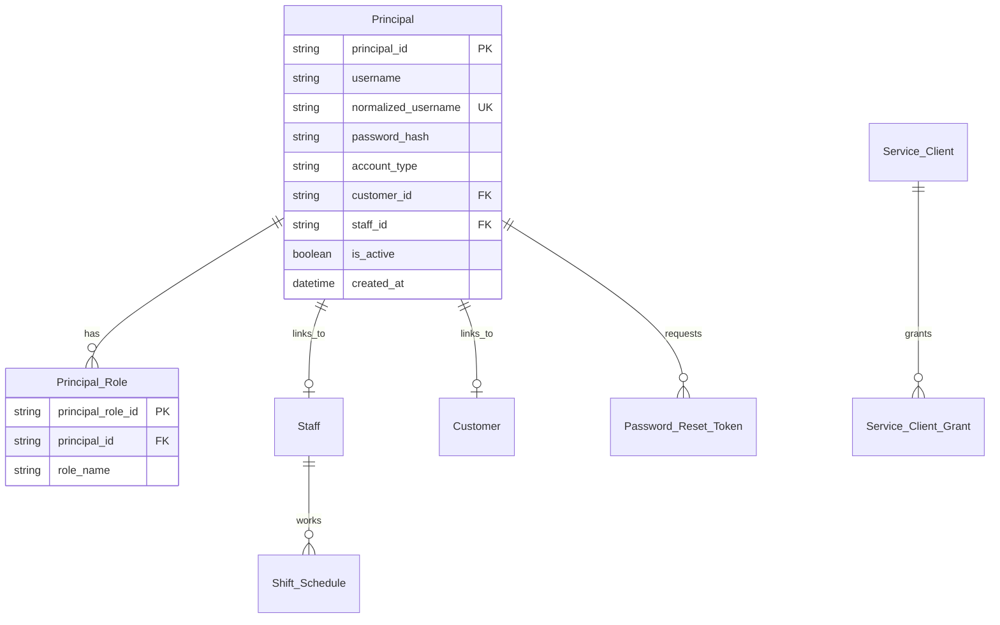

# BÁO CÁO THIẾT KẾ VÀ DI CHUYỂN DỮ LIỆU TÀI KHOẢN & PHÂN QUYỀN
## (ACCOUNT AND ROLE/PERMISSION DATA MIGRATION REPORT)

- **Người phụ trách (In-charge):** Nguyễn Phước Thịnh (MSSV: CE190087)
- **Feature:** Identity Service
- **Milestone:** M3 (Chuẩn bị từ M0 - M2)
- **Tài liệu tham chiếu:** `AGENTS_1.3.md` (Mục 3, 7, 10, 19, 20, 24, 25)

---

## 1. MỤC TIÊU & BỐI CẢNH

Trong hệ thống Monolith cũ:
- Bảng `Customer` và bảng `Staff` là 2 bảng tách rời hoàn toàn, không có cơ chế định danh tập trung.
- `Customer` không có bảng role riêng.
- `Staff` có cột `position` chứa các chuỗi tự do (`ROLE_ADMIN`, `ROLE_CASHIER_STAFF`).
- Tồn tại tài khoản khách vãng lai (`KH000000` - Walk-in Customer) có mật khẩu là plaintext (`default123`).
- Tồn tại nguy cơ va chạm username giữa Customer và Staff nếu người dùng đặt trùng tên đăng nhập.

**Mục tiêu của Task 2:**
1. Thiết kế cơ sở dữ liệu `identity_db` độc lập theo chuẩn **Database-per-Service**.
2. Thống nhất cơ chế xác thực vào một thực thể duy nhất: **`Principal`** (phục vụ ký JWT bất đối xứng RS256 sau này).
3. Chuẩn hóa hệ thống quyền thành 4 Role chính thức: `USER`, `CASHIER_STAFF`, `REDEMPTION_STAFF`, `ADMIN`.
4. Cung cấp bộ script Flyway Migration (`V1` và `V2`) cùng công cụ đối soát dữ liệu (Reconciliation & Audit).

---

## 2. BẢNG ÁNH XẠ DỮ LIỆU (MIGRATION MAPPING TABLE)

| Nguồn (Monolith cũ) | Đích (`identity_db`) | Quy tắc chuyển đổi |
|---|---|---|
| `Staff` (`staff_id` varchar(8)) | `Staff` (`staff_id` varchar(36)) | Mở rộng kiểu dữ liệu lên VARCHAR(36) để hỗ trợ UUID mới, bảo lưu ID cũ (`ST000001`, `ST000004`). |
| `Customer` (`user_id` varchar(8)) | `Customer` (`user_id` varchar(36)) | Mở rộng lên VARCHAR(36), bảo lưu ID cũ (`CS000001` - `CS000008`, `KH000000`). |
| `Staff` + `Customer` | **`Principal`** (Bảng mới) | Tạo bản ghi định danh chung: `principal_id` (UUID lowercase), `normalized_username` (lowercase & trim). `account_type` = `STAFF` hoặc `CUSTOMER`. |
| `Staff.position = 'ROLE_ADMIN'` | **`Principal_Role`** | Ánh xạ sang Role chuẩn: **`ADMIN`** |
| `Staff.position = 'ROLE_CASHIER_STAFF'` | **`Principal_Role`** | Ánh xạ sang Role chuẩn: **`CASHIER_STAFF`** |
| Toàn bộ `Customer` | **`Principal_Role`** | Ánh xạ sang Role chuẩn: **`USER`** |
| Mật khẩu `default123` (`KH000000`) | `Principal.password_hash` | Băm mật khẩu bằng **BCrypt cost = 12**, xóa bỏ hoàn toàn plaintext trong DB. |

---

## 3. CẤU TRÚC BẢNG TRONG `identity_db`

---

## 4. QUY TRÌNH FLYWAY MIGRATION

1. **`V1__init_identity_schema.sql`**:
   - Tạo 7 bảng độc lập trong `identity_db`: `Staff`, `Customer`, `Shift_Schedule`, `Principal`, `Principal_Role`, `Password_Reset_Token`, `Service_Client`, `Service_Client_Grant`.
   - Ràng buộc toàn vẹn: Khóa ngoại, CHECK constraint cho `account_type` (`CUSTOMER`, `STAFF`) và `role_name` (`USER`, `CASHIER_STAFF`, `REDEMPTION_STAFF`, `ADMIN`).

2. **`V2__migrate_legacy_accounts_and_roles.sql`**:
   - ETL toàn bộ tài khoản `Staff` cũ: tạo `Principal` dạng `p-staff-<staff_id>` và gán quyền `ADMIN` hoặc `CASHIER_STAFF`.
   - ETL toàn bộ tài khoản `Customer` cũ: tạo `Principal` dạng `p-cust-<user_id>` và gán quyền `USER`.
   - Tự động thay thế mật khẩu plaintext của tài khoản vãng lai `KH000000` thành hash BCrypt cost 12 an toàn.

---

## 5. CÔNG CỤ ĐỐI SOÁT DỮ LIỆU (RECONCILIATION API)

Trong `AccountMigrationService.java` và `MigrationAuditController.java`, đã xây dựng 2 API:
- `GET /api/v1/admin/migration/audit`:
  - Trả về số lượng Customer, Staff, Principal, và phân bổ từng Role.
  - Tự động kiểm tra điều kiện `total_legacy_customers == customer_principals` và `total_legacy_staffs == staff_principals`. Nếu khớp 100% $\rightarrow$ Trạng thái `RECONCILED_SUCCESS`.
- `POST /api/v1/admin/migration/reconcile`:
  - Tự động đối soát và vá các tài khoản bị thiếu nếu phát hiện lỗi bất đồng bộ.
